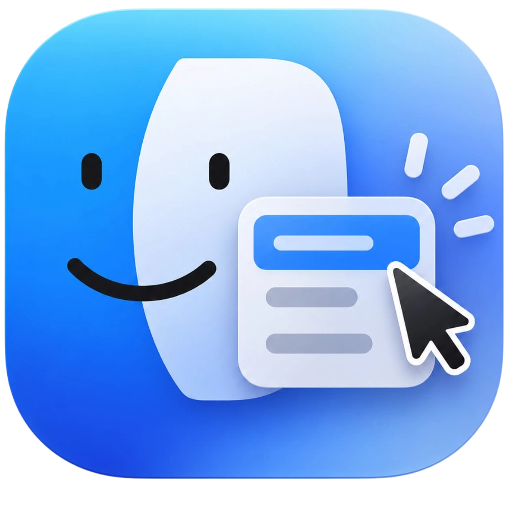
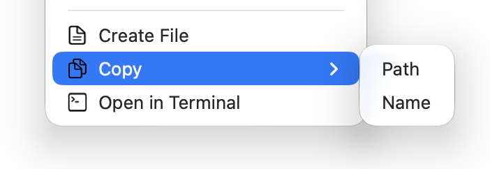
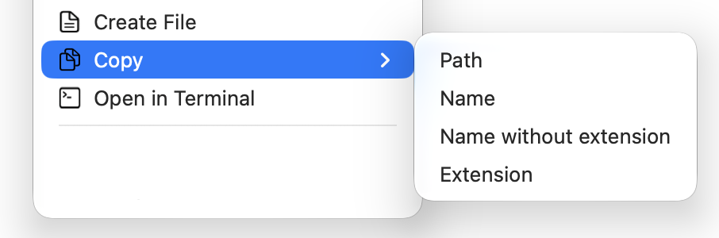
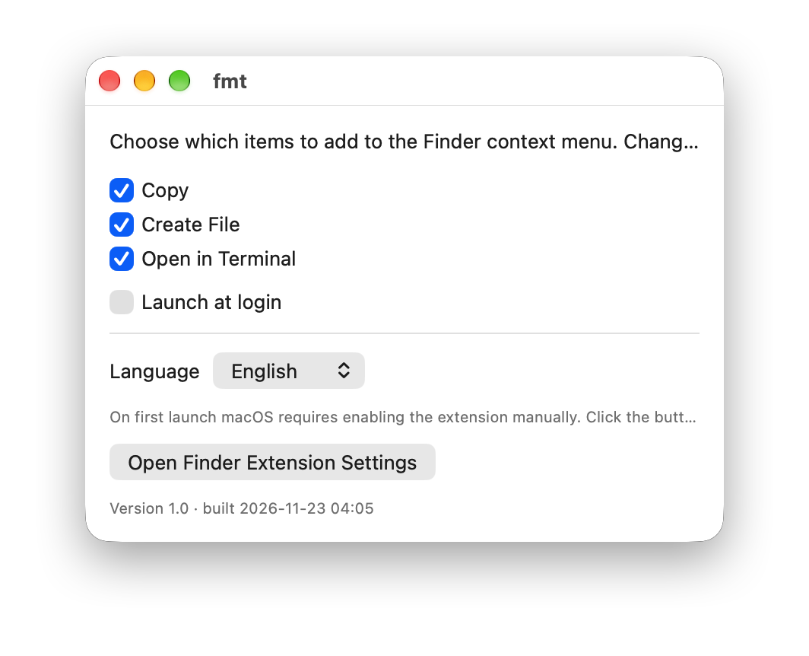

# fmt



**fmt** is a small macOS menu bar app that adds useful actions to the Finder
context menu: create a file, copy a path, name or extension, and open a folder in
Terminal. Every item can be turned on or off in Settings.



## What it does

- **Create File** — creates `file.txt` at the place you right-clicked. If the
  name is taken, it uses `file 2.txt`, `file 3.txt`, and so on — existing files
  are never overwritten.
- **Copy** — a submenu with **Path** (the path of the folder or file you clicked),
  **Name** (the full name including the extension, e.g. `README.md`),
  **Name without extension** (`README`), and **Extension** (`md`). For folders
  only **Path** and **Name** are shown — a folder has no extension or stem.
- **Open in Terminal** — opens a new Terminal.app window in that folder.



`fmt` lives in the menu bar (icon on the right) and does not show a Dock icon.
Click it → **Settings...** to open the settings window. Uncheck a box and the
corresponding item disappears from the Finder menu immediately — no extension
restart is needed. Settings are stored in
`/Users/Shared/fmt/menu-settings.json`.

The settings window has a language picker (System / English / Русский), a
**Launch at login** checkbox, and the app version with its build date. The chosen
language is used by both the app and the Finder menu. With **System**, the language
comes from macOS. Strings live in `Shared/Localizable.xcstrings`.

Launch at login uses `SMAppService` (`fmt/LaunchAtLogin.swift`); no helper app is
needed. If macOS asks for confirmation, a hint appears in Settings — enable fmt
under **System Settings → General → Login Items & Extensions**.

Clicking **Settings...** again raises the existing window and makes it key
instead of opening a second one (`fmt/SettingsWindow.swift`).



The menu bar icon is a `template` PNG mask, 22×22 / 44×44 px, in
`fmt/Assets.xcassets/MenuBarIcon.imageset`: a filled disc with the artwork cut
out of it. macOS tints it automatically, so it looks right in both light and dark
mode. For a colorful icon, remove `.renderingMode(.template)` in `fmt/MyApp.swift`.

## Installation

```bash
./scripts/install.sh
```

The script builds the app, copies it to `/Applications/fmt.app`, registers and
enables the extension with `pluginkit`, and restarts Finder. On first launch
macOS may ask for confirmation: open **System Settings → General → Login Items &
Extensions → Finder Extensions** and enable **fmt**.

If the menu does not appear right away, hold ⌥, right-click the Finder icon in
the Dock, and choose **Relaunch**.

You can also just build the app in Xcode (scheme `fmt`, destination `macOS`) and
run it: the icon appears in the menu bar and opens Settings.

### Installing the release archive

The ZIP attached to the GitHub Release is a universal build (arm64 + x86_64)
for **macOS 14 or newer**. It is signed with an Apple Development certificate
and is not notarized, so Gatekeeper blocks the first launch. To install it:

1. Unzip the archive and move `fmt.app` to `/Applications`.
2. Allow the first launch in one of two ways:
   - run `xattr -d com.apple.quarantine /Applications/fmt.app`, then open it
     normally;
   - or open it once, then go to **System Settings → Privacy & Security →
     Open Anyway**.
3. Enable the extension in **System Settings → General → Login Items &
   Extensions → Finder Extensions**.

Right-click → Open no longer works for this on recent macOS versions.

## How it works

- `fmt` is a container SwiftUI app.
- `fmtFinder` is a Finder Sync extension. It observes `/`, so the menu works on
  the Desktop, in regular folders, and on external drives.
- Creating a file needs write access to the file system
  (`fmtFinder/fmtFinder.entitlements`). A Finder Sync extension must be sandboxed.
- `app.webp` is the source artwork for the icons. If you replace it, run:

  ```bash
  ./scripts/build-icons.sh        # or: ./scripts/build-icons.sh path/to/other.png
  ./scripts/install.sh
  ```

  The script converts the image to PNG, crops it to a square if needed, and
  creates every size in `fmt/Assets.xcassets/AppIcon.appiconset`. It also rebuilds
  the template icon for the menu bar.

### Limitations

macOS does not show third-party Finder Sync extension menus in File Provider
folders (iCloud Drive, OneDrive, Dropbox, etc.). Local folders and the Desktop
work fine.

## License

MIT — see [LICENSE](LICENSE).
